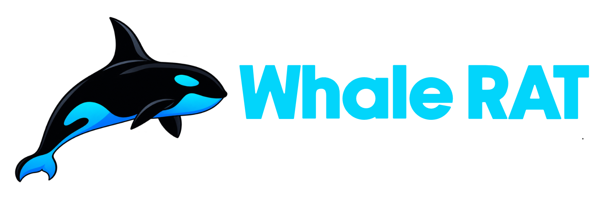

  
  
  # WhaleRAT
  ### Telegram & Web-Based Android Remote Administration Tool

  
  
  
  **A dual-mode, firewall-bypassing Android RAT designed for lab emulation, boundary analysis, and defensive security testing without requiring local port forwarding.**

---

## 🛑 Disclaimer & Legal Warning
**WhaleRAT is intended exclusively for authorized security research, academic studies, and defensive engineering.** 

Using this software against targets without explicit, prior, written consent is strictly illegal and subject to severe criminal liability. The developers assume no responsibility for misuse, damage, or malicious actions executed via this codebase.

## 📄 License
This project is open-source and distributed under the [MIT License](LICENSE).
